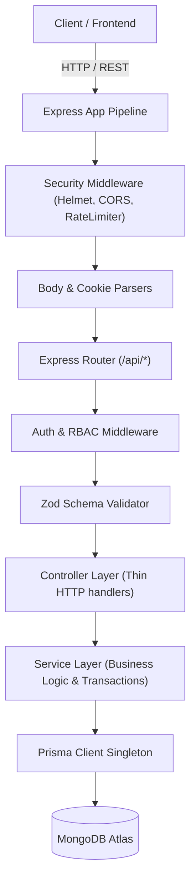

# SKILLORITY — BACKEND ARCHITECTURE SPECIFICATION

> **Platform**: Skillority — Professional Learning & Verified Career Platform  
> **Backend Architecture**: Node.js, Express (ES Modules), Prisma ORM, MongoDB Atlas  
> **Security Baseline**: JWT (Access + Refresh tokens with rotation), bcrypt, Helmet, CORS, express-rate-limit, Zod

---

## 1. Architectural Principles & Module Organization

The backend follows a layered, decoupled service-oriented MVC architecture:



### Module Organization
```
backend/
├── src/
│   ├── app.js                       # Express application pipeline
│   ├── server.js                    # HTTP listener, DB ping & graceful shutdown
│   ├── config/
│   │   ├── database.js              # PrismaClient singleton with connection resilience
│   │   └── env.js                   # Strict environment variable validation
│   ├── middleware/
│   │   ├── auth.middleware.js       # JWT extraction, user state hydration, RBAC guards
│   │   ├── error.middleware.js      # Global error handler with clean sanitized output
│   │   ├── ownership.middleware.js  # Resource ownership validation
│   │   └── rateLimiter.js           # Tiered rate limiters (API, Auth, Financial)
│   ├── routes/
│   │   ├── auth.routes.js           # Auth & session lifecycle endpoints
│   │   ├── profile.routes.js        # User profiles & account settings
│   │   ├── course.routes.js         # Courses, curriculum, review & publication
│   │   ├── learning.routes.js       # Enrollments, progress & chapter unlocking
│   │   ├── assessment.routes.js     # Quizzes, final exams & certificates
│   │   ├── wallet.routes.js         # Coin economy, rewards, transactions
│   │   ├── career.routes.js         # Opportunities, applications & pipeline
│   │   ├── community.routes.js      # Posts, comments, reactions
│   │   ├── messaging.routes.js      # Conversations & messages
│   │   ├── notification.routes.js   # In-app notifications
│   │   └── admin.routes.js          # Platform management & audits
│   ├── controllers/                 # Route handler functions
│   ├── services/                    # Encapsulated core business logic & rules
│   ├── validators/                  # Zod input schemas
│   └── utils/                       # Security, crypto, JWT, pagination helpers
```

---

## 2. API Route Conventions & Global Standards

- **Base URL Prefix**: `/api/v1` (with `/api` compatibility aliases).
- **HTTP Methods**:
  - `GET`: Read resources (idempotent, cacheable where appropriate).
  - `POST`: Create resource or execute non-idempotent action (e.g., `/claim-reward`).
  - `PATCH` / `PUT`: Update existing resource.
  - `DELETE`: Remove resource.
- **Unified Response Schema**:
  ```json
  // Success Response
  {
    "success": true,
    "data": { ... },
    "meta": {
      "page": 1,
      "limit": 20,
      "total": 142,
      "totalPages": 8
    }
  }

  // Error Response
  {
    "success": false,
    "error": {
      "code": "VALIDATION_ERROR | UNAUTHORIZED | FORBIDDEN | NOT_FOUND | CONFLICT | RATE_LIMITED | INTERNAL_ERROR",
      "message": "Human-readable description",
      "details": [
        { "field": "email", "issue": "Invalid email address format" }
      ]
    }
  }
  ```

---

## 3. Authentication, RBAC & Security Strategy

1. **Token Lifetime & Storage**:
   - **Access Token**: Short-lived (15 minutes), payload `{ sub: userId, role, tokenVersion }`. Passed via `Authorization: Bearer <token>`.
   - **Refresh Token**: Long-lived (7 days), stored hashed in database (`RefreshToken` model), transferred via `HttpOnly`, `SameSite: Strict`, `Secure: true` cookie.
   - **Token Versioning**: `tokenVersion` stored on `User`. Incremented on role revocation, suspension, or password reset to immediately invalidate all active access tokens.
2. **Refresh Token Reuse Detection**:
   - If an already-revoked refresh token is presented, the system detects token theft and invalidates **all** active refresh tokens for that user immediately.
3. **Role Authorization Matrix**:
   - `STUDENT`: Learning, enrollment, quizzes, certificates, career applications, wallet rewards, community, messages.
   - `COMPANY`: Opportunity management, candidate talent search, application reviews, candidate messaging.
   - `INSTRUCTOR`: Course creation, chapter/lesson authoring, quiz/assessment builder, student progress viewing. Courses must be submitted for Admin approval.
   - `ADMIN`: User management (suspend/restore), course review (approve/reject), platform telemetry, invitations.

---

## 4. Product Business Rules Enforcement

- **Course Hierarchy**: `Course → Chapters → Lessons → Chapter Quiz → Final Assessment`. Strictly enforced; no module layer permitted.
- **Freemium Chapter Unlocking**:
  - Chapters with `order` 0 through 5 are free (`isFree = true`, `coinsCost = 0`).
  - Chapter index 6+ requires `coinsCost` Coins deduction from the student's `Wallet`.
  - Server validates wallet balance and creates atomic `WalletTransaction` (`CHAPTER_UNLOCK`).
- **Separate Certificates**:
  - `CourseCompletionCertificate`: Issued automatically when 100% of lessons in an approved course are completed.
  - `FinalAssessmentCertificate`: Issued only when the course's final assessment is passed at or above the designated passing threshold.
- **Coins Economy Integrity**:
  - All balance changes must be committed via `prisma.$transaction`.
  - Duplicate reward checks (e.g. daily login claims, daily missions capped at 25 Coins/day) are strictly enforced by checking existing transactions within the same 24-hour UTC window.
