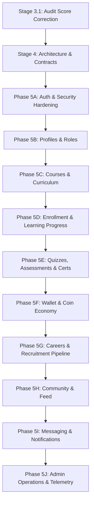

# SKILLORITY — BACKEND IMPLEMENTATION ROADMAP

> **Execution Strategy**: Phased, incremental, test-backed implementation  
> **Rule**: No mock responses; strictly verified Prisma database interactions.

---

## Roadmap Phases

---

## Detailed Milestones

| Milestone | Scope | Deliverables | Tests |
|---|---|---|---|
| **Phase 5A** | Security & Auth Hardening | Fix JWT fallback secrets, fail-closed DB checks, refresh token rotation, strict cookie handling, tokenVersion revocation | `auth.unit.test.js`, `auth.api.test.js`, `security.test.js` |
| **Phase 5B** | Profiles & RBAC | Student, Company, Instructor profile endpoints, update validators, ownership guards | `profile.test.js` |
| **Phase 5C** | Courses & Curriculum | Course CRUD, Chapter & Lesson builders, Admin review submission, publication gate | `course.test.js` |
| **Phase 5D** | Enrollment & Learning | Course enrollment, free/paid chapter gate, lesson completion, progress % | `learning.test.js` |
| **Phase 5E** | Quizzes & Certs | Chapter quiz evaluation, final assessment passing rules, dual certificate issuance | `assessment.test.js` |
| **Phase 5F** | Wallet & Coins | Atomic transactions, chapter unlocks, daily login bonus, rewarded ad probability distribution | `wallet.test.js` |
| **Phase 5G** | Careers & Recruitment | Opportunity CRUD, student applications, recruiter Kanban pipeline stages | `career.test.js` |
| **Phase 5H** | Community | Posts feed, tags filtering, comments, like toggle | `community.test.js` |
| **Phase 5I** | Messaging & Notifications | One-to-one chats, message read status, user notifications | `messaging.test.js` |
| **Phase 5J** | Admin Management | User suspension/activation, platform metrics, audit trail | `admin.test.js` |
