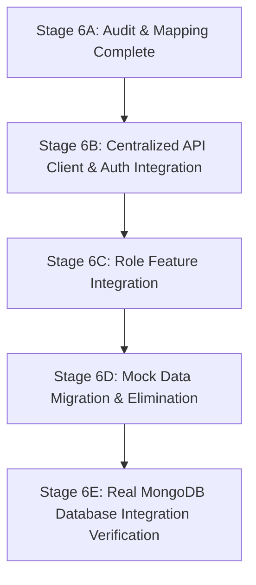

# SKILLORITY — FRONTEND ↔ BACKEND INTEGRATION ROADMAP

> **Sequence**: 6A (Map) → 6B (API Client & Auth) → 6C (Domain Features) → 6D (Mock Migration) → 6E (Database Verification)  
> **Rule**: Real REST calls with intelligent mock-fallbacks during offline/test development, strictly upholding Stitch designs.

---

## 1. Integration Stages & Priorities

---

## 2. Milestone Execution Breakdown

### Milestone 6B: Universal API Client & Session Infrastructure
- Create `frontend/src/lib/apiClient.js` supporting:
  - Base URL configuration (`NEXT_PUBLIC_API_URL` or `http://localhost:5000/api`).
  - Automatic `Bearer` token attachment from secure storage.
  - Automatic handling of 401 Unauthorized via refresh token rotation.
  - AbortController and request timeouts.
  - Unified error unwrapping (`{ code, message, details }`).
- Upgrade `frontend/src/lib/auth.js`:
  - Connect `loginUser`, `logoutUser`, `refreshSession`, and `getMe`.
  - Ensure zero sensitive token leakage.

### Milestone 6C: Domain-by-Domain Feature Connectors
- **Profiles**: `frontend/src/lib/api/profiles.js` (`getMyProfile`, `updateProfile`, `getPublicProfile`).
- **Courses & Learning**: `frontend/src/lib/api/courses.js` & `learning.js` (`getCourses`, `getCourse`, `enroll`, `completeLesson`, `unlockChapter`).
- **Assessments & Quizzes**: `frontend/src/lib/api/assessments.js` (`submitQuiz`, `submitAssessment`, `claimCertificate`).
- **Wallet & Coins**: `frontend/src/lib/api/wallet.js` (`getWallet`, `claimDailyLogin`, `claimAdReward`).
- **Careers & Applications**: `frontend/src/lib/api/careers.js` (`getOpportunities`, `apply`, `updateApplicationStatus`).
- **Community**: `frontend/src/lib/api/community.js` (`getPosts`, `createPost`, `toggleLike`, `addComment`).
- **Messaging & Notifications**: `frontend/src/lib/api/messaging.js` (`getConversations`, `sendMessage`, `getNotifications`).
- **Admin**: `frontend/src/lib/api/admin.js` (`getUsers`, `updateUserStatus`, `getStats`, `getReviewQueue`).

### Milestone 6D: Mock Data Fallback Migration
- Implement resilient data hooks / services in frontend pages that query the real backend first.
- If backend responds with database offline or 503, provide seamless mock fallback to preserve UI rendering during development without crash.

### Milestone 6E: Database Verification
- Run database connection check.
- Execute automated end-to-end simulation across all 10 domain endpoint sets.
