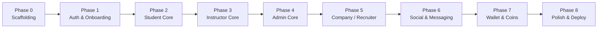
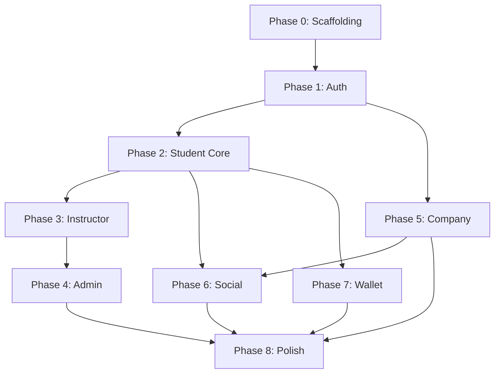

# Skillority — Implementation Roadmap

This roadmap defines the phased delivery plan for the Skillority platform. Each phase lists its deliverables, screens covered, estimated effort, and dependencies.

---

## Phase Overview

---

## Phase 0 — Project Scaffolding ✅ (COMPLETED)

**Effort:** 1 day  
**Status:** ✅ Completed in Phase 1 Scaffolding task  
**Dependencies:** None  
**Blockers:** None

### Completed Deliverables

| # | Task | Details | Status |
|---|------|---------|:------:|
| 0.1 | Git configuration | `.gitignore` established | ✅ |
| 0.2 | Scaffold frontend | Next.js 14 App Router, JavaScript/JSX, Tailwind CSS | ✅ |
| 0.3 | Scaffold backend | Express.js REST API with health check endpoint | ✅ |
| 0.4 | Configure Tailwind tokens | `#2563EB` primary, `#F8FAFC` canvas, Geist fonts, 12px radius | ✅ |
| 0.5 | Configure Geist fonts | Configured in root layout via `next/font/google` | ✅ |
| 0.6 | Configure Lucide icons | Added to frontend dependencies | ✅ |
| 0.7 | Configure Prisma MongoDB | MongoDB provider schema with verified models & RBAC enums | ✅ |
| 0.8 | Environment templates | Frontend & Backend `.env.example` templates | ✅ |
| 0.9 | pnpm workspaces | `pnpm-workspace.yaml` isolating `frontend` and `backend` | ✅ |
| 0.10 | Code linting | ESLint configured for both frontend and backend | ✅ |

### Screens Covered
None directly — this phase provides infrastructure.

---

## Phase 1 — Authentication & Onboarding

**Effort:** 3–4 days
**Dependencies:** Phase 0
**Blockers:** MongoDB Atlas connection string, email service credentials

### Deliverables

| # | Task | Screens |
|---|------|---------|
| 1.1 | Landing page | Public Landing Page |
| 1.2 | Sign Up flow | Sign Up |
| 1.3 | Email verification | Email Verification |
| 1.4 | Sign In flow | Sign In |
| 1.5 | Forgot password | Forgot Password |
| 1.6 | Password reset | Password Reset |
| 1.7 | Role selection | Role Selection |
| 1.8 | Student onboarding | Student Onboarding |
| 1.9 | Company onboarding | Company Onboarding |
| 1.10 | Instructor onboarding | Instructor Onboarding |

### Backend APIs
- `POST /api/auth/signup`
- `POST /api/auth/signin`
- `POST /api/auth/signout`
- `POST /api/auth/refresh`
- `POST /api/auth/verify-email`
- `POST /api/auth/forgot-password`
- `POST /api/auth/reset-password`
- `POST /api/auth/select-role`
- `POST /api/onboarding/student`
- `POST /api/onboarding/company`
- `POST /api/onboarding/instructor`

### Prisma Models
- `User` (with role, email, passwordHash)
- `Profile` (linked to User)
- `VerificationToken`
- `PasswordResetToken`

### Screens Covered: 10

---

## Phase 2 — Student Core Learning ✅ (UI-2 COMPLETED)

**Effort:** 5–6 days  
**Status:** ✅ Frontend UI & Learning Experience Completed & Verified (Report: `docs/UI_PHASE_2_REPORT.md`)  
**Dependencies:** Phase 1  
**Blockers:** None (uses seeded / mock learning data)

### Deliverables

| # | Task | Screens | Status |
|---|------|---------|:------:|
| 2.1 | Student dashboard | Student Dashboard | ✅ |
| 2.2 | Learn Hub (course catalog) | Learn Hub | ✅ |
| 2.3 | Course details page | Course Details | ✅ |
| 2.4 | Chapter details & unlock logic | Chapter Details | ✅ |
| 2.5 | Lesson viewer | Student Lesson Viewer | ✅ |
| 2.6 | Chapter quiz | Chapter Quiz | ✅ |
| 2.7 | Final assessment | Final Assessment | ✅ |
| 2.8 | Learning progress tracker | Learning Progress |
| 2.9 | Student profile | Student Profile |
| 2.10 | Student settings | Student Settings |

### Backend APIs
- `GET /api/courses` (catalog with filters)
- `GET /api/courses/:id`
- `GET /api/courses/:id/chapters`
- `GET /api/courses/:id/chapters/:chapterId`
- `GET /api/courses/:id/chapters/:chapterId/lessons/:lessonId`
- `POST /api/courses/:id/chapters/:chapterId/quiz/submit`
- `POST /api/courses/:id/assessment/submit`
- `GET /api/student/progress`
- `GET /api/student/profile`
- `PUT /api/student/profile`
- `PUT /api/student/settings`
- `POST /api/courses/:id/enroll`

### Prisma Models (new/extended)
- `Course`, `Chapter`, `Lesson`
- `Enrollment`
- `QuizAttempt`
- `AssessmentAttempt`
- `LessonProgress`

### Business Rules
- Chapters 0–5 are free; higher chapters require Coins
- Track lesson completion and quiz scores
- Calculate course progress percentage

### Screens Covered: 10

---

## Phase 3 — Instructor Core

**Effort:** 6–7 days
**Dependencies:** Phase 2 (shared Course models)
**Blockers:** None

### Deliverables

| # | Task | Screens |
|---|------|---------|
| 3.1 | Instructor dashboard | Instructor Dashboard |
| 3.2 | My courses list | Instructor My Courses |
| 3.3 | Create course wizard | Instructor Create Course |
| 3.4 | Course management overview | Instructor Course Management Overview |
| 3.5 | Curriculum builder | Course Curriculum Builder |
| 3.6 | Hybrid lesson builder | Instructor Hybrid Lesson Builder |
| 3.7 | Lesson basics creation | Instructor: Create Lesson Basics |
| 3.8 | Lesson builder workspace | Instructor: Lesson Builder Workspace |
| 3.9 | Add block menu | Instructor: Add Block Menu |
| 3.10 | Lesson preview | Instructor Lesson Preview |
| 3.11 | Assessment builder | Instructor Assessment Builder |
| 3.12 | Assessment preview | Instructor Assessment Preview |
| 3.13 | Student management dashboard | Instructor Student Management Dashboard |
| 3.14 | Student directory | Instructor Student Directory |
| 3.15 | Student profile & progress view | Instructor Student Profile & Learning Progress |
| 3.16 | Student course progress | Instructor Student Course Progress |
| 3.17 | Instructor profile | Instructor My Profile |
| 3.18 | Instructor settings | Instructor Settings |
| 3.19 | Instructor notifications | Instructor Notifications |

### Backend APIs
- `POST /api/instructor/courses`
- `PUT /api/instructor/courses/:id`
- `POST /api/instructor/courses/:id/submit-review`
- `POST /api/instructor/courses/:id/chapters`
- `PUT /api/instructor/courses/:id/chapters/:chapterId`
- `POST /api/instructor/courses/:id/chapters/:chapterId/lessons`
- `PUT /api/instructor/courses/:id/chapters/:chapterId/lessons/:lessonId`
- `GET /api/instructor/students`
- `GET /api/instructor/students/:id`
- `GET /api/instructor/analytics`

### Business Rules
- Instructors can ONLY access via Admin invitation
- Instructors manage ONLY their own courses
- Courses require Admin approval before publication
- Course status flow: Draft → Pending Review → Approved/Rejected → Published

### Screens Covered: 19

---

## Phase 4 — Admin Core

**Effort:** 4–5 days
**Dependencies:** Phase 3 (course review depends on instructor submissions)
**Blockers:** None

### Deliverables

| # | Task | Screens |
|---|------|---------|
| 4.1 | Admin dashboard | Admin Dashboard |
| 4.2 | User management directory | User Management Directory |
| 4.3 | User details & account overview | User Details & Account Overview |
| 4.4 | User account actions (suspend, ban, promote) | User Account Management & Status Actions |
| 4.5 | Course review dashboard | Course Review Dashboard |
| 4.6 | Course review details | Course Review Details |
| 4.7 | Approval / rejection interface | Approval / Rejection Decision Interface |
| 4.8 | Platform activity dashboard | Platform Activity Dashboard |
| 4.9 | Activity log & event details | Activity Log & Event Details |
| 4.10 | Reports & analytics | Reports & Analytics |
| 4.11 | Admin notifications | Admin Notifications |
| 4.12 | Admin settings | Admin Account Settings |
| 4.13 | Admin profile | Admin Personal Profile |

### Backend APIs
- `GET /api/admin/users` (paginated, filterable)
- `GET /api/admin/users/:id`
- `PUT /api/admin/users/:id/status` (activate, suspend, ban)
- `POST /api/admin/users/invite-instructor`
- `PUT /api/admin/users/:id/role`
- `GET /api/admin/courses/reviews`
- `GET /api/admin/courses/reviews/:id`
- `POST /api/admin/courses/reviews/:id/decide`
- `GET /api/admin/activity`
- `GET /api/admin/reports`

### Business Rules
- Admin assigns and revokes Instructor permissions
- Course approval/rejection with notes
- Activity logging for audit trail

### Screens Covered: 13

---

## Phase 5 — Company / Recruiter

**Effort:** 5–6 days
**Dependencies:** Phase 2 (student profiles for talent discovery)
**Blockers:** None

### Deliverables

| # | Task | Screens |
|---|------|---------|
| 5.1 | Company dashboard | Company Dashboard |
| 5.2 | Opportunities dashboard | Company Opportunities Dashboard |
| 5.3 | Create opportunity | Create Opportunity |
| 5.4 | Edit opportunity | Edit Opportunity |
| 5.5 | Opportunity details & applicants | Opportunity Details & Applicant Overview |
| 5.6 | Applications inbox | Company Applications Inbox |
| 5.7 | Application details | Application Details |
| 5.8 | Talent discovery search | Company Talent Discovery |
| 5.9 | Student talent profile (recruiter view) | Student Talent Profile (Recruiter View) |
| 5.10 | Saved candidates | Saved Candidates |
| 5.11 | Candidate evaluation | Candidate Evaluation |
| 5.12 | Recruitment pipeline | Recruitment Pipeline |
| 5.13 | Company public profile | Company Public Profile |
| 5.14 | Recruiter personal profile | Recruiter Personal Profile |
| 5.15 | Recruiter account settings | Recruiter Account Settings |
| 5.16 | Recruiter notifications | Recruiter Notifications |
| 5.17 | Recruiter messages | Recruiter Messages |
| 5.18 | One-to-one candidate chat | One-to-One Candidate Chat |

### Prisma Models (new)
- `Opportunity`
- `Application`
- `SavedCandidate`
- `CandidateEvaluation`
- `PipelineStage`

### Screens Covered: 18

---

## Phase 6 — Social & Messaging

**Effort:** 4–5 days
**Dependencies:** Phase 2, Phase 5

### Deliverables

| # | Task | Screens | Status |
|---|------|---------|:------:|
| 6.1 | Community feed | Community Feed | ⬜ Not Implemented |
| 6.2 | Create community post | Create Community Post | ⬜ Not Implemented |
| 6.3 | One-to-one student chat | One-to-One Student Chat | ⬜ Not Implemented |
| 6.4 | Student notifications | Notifications (Student) | ⬜ Not Implemented |
| 6.5 | Student career opportunities | Student Career Opportunities | ✅ Implemented (Phase UI-3A) |
| 6.6 | Opportunity details & application | Opportunity Details & Application | ✅ Implemented (Phase UI-3A) |
| 6.7 | My applications & saved | My Applications & Saved Opportunities | ✅ Implemented (Phase UI-3A) |

### Prisma Models (new)
- `CommunityPost`, `Comment`, `Like`
- `Conversation`, `Message`
- `Notification`

### Screens Covered: 7

---

## Phase 7 — Wallet & Coins

**Effort:** 2–3 days
**Dependencies:** Phase 2

### Deliverables

| # | Task | Screens |
|---|------|---------|
| 7.1 | Coins wallet | Coins Wallet |
| 7.2 | Transaction history | _(within wallet screen)_ |
| 7.3 | Chapter unlock with coins | _(integration with Chapter Details)_ |

### Prisma Models (new)
- `Wallet`
- `Transaction`

### Business Rules
- Coins are internal utility credits, NOT real currency
- Chapters 0–5 free; advanced chapters cost Coins
- Track all transactions with descriptions

### Screens Covered: 1 (+ integrations)

---

## Phase 8 — Polish & Deployment

**Effort:** 3–5 days
**Dependencies:** All previous phases

### Deliverables

| # | Task |
|---|------|
| 8.1 | Responsive design pass (tablet + mobile) |
| 8.2 | Loading states & skeleton screens |
| 8.3 | Error boundary & fallback pages (404, 500) |
| 8.4 | SEO metadata & Open Graph tags |
| 8.5 | Performance audit (Lighthouse) |
| 8.6 | Accessibility audit (WCAG 2.1 AA) |
| 8.7 | End-to-end testing (critical flows) |
| 8.8 | Deploy frontend (Vercel) |
| 8.9 | Deploy backend (Railway / Render) |
| 8.10 | Setup CI/CD pipeline |

---

## Total Effort Estimate

| Phase | Effort | Cumulative |
|-------|--------|-----------|
| Phase 0 — Scaffolding | 1 day | 1 day |
| Phase 1 — Auth & Onboarding | 3–4 days | 4–5 days |
| Phase 2 — Student Core | 5–6 days | 9–11 days |
| Phase 3 — Instructor Core | 6–7 days | 15–18 days |
| Phase 4 — Admin Core | 4–5 days | 19–23 days |
| Phase 5 — Company / Recruiter | 5–6 days | 24–29 days |
| Phase 6 — Social & Messaging | 4–5 days | 28–34 days |
| Phase 7 — Wallet & Coins | 2–3 days | 30–37 days |
| Phase 8 — Polish & Deploy | 3–5 days | 33–42 days |

**Total: ~5–6 weeks** for a single developer working full-time.

---

## Dependency Graph

---

## Next Steps

> [!IMPORTANT]
> **Immediate action required:** Approve this roadmap, then we begin **Phase 0: Project Scaffolding**.
>
> Phase 0 has **zero external dependencies** and produces a runnable skeleton for both frontend and backend.

