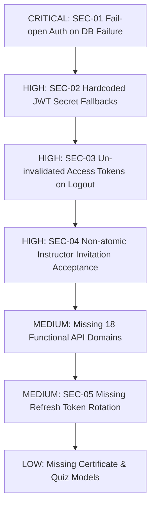
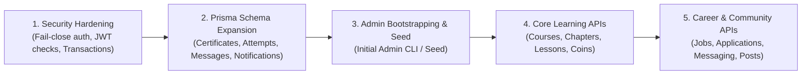

# SKILLORITY — STAGE 3: BACKEND AUDIT REPORT
**Comprehensive Read-Only Backend & Database Audit**

- **Date**: November 15, 2026
- **Auditor**: Senior Backend Architect & Security Auditor
- **Repository**: `https://github.com/omarmechergui/skillority`
- **Audit Mode**: READ-ONLY (No code, schema, config, or dependency modifications)
- **Status**: Complete

---

## 1. Executive Summary

This audit delivers an exhaustive analysis of the Skillority backend codebase located under `backend/`. The backend is a Node.js Express REST API paired with Prisma ORM connecting to MongoDB.

### Overall Backend Readiness Score: **49.8%**

The scoring is derived across four critical dimensions:

| Dimension | Weight | Earned Score | Weighted Contribution | Summary / Status |
|---|:---:|:---:|:---:|---|
| **Architecture & Core Foundation** | 20% | 70% | 14.0% | Solid Express scaffolding, Helmet, CORS, Rate-Limiting, Cookie-parser, Zod, and Prisma Client singleton. Missing graceful DB shutdown, structured logger, and unified exception handling. |
| **Authentication & RBAC Security** | 25% | 75% | 18.75% | Rigorous password hashing (bcrypt 12 rounds), dual-token JWT architecture, tokenVersion session invalidation, and strict role guards. Significant vulnerabilities found in fail-open auth fallback, JWT secret fallback, and missing verification/reset delivery services. |
| **Prisma & Data Modeling** | 20% | 60% | 12.0% | 12 Prisma models with relations and enums. However, missing key models (Certificates, Messages, Notifications, Quizzes/Attempts, AdRewards, Mission/Streak logs) and referential integrity constraints required by MongoDB. |
| **Functional API Domain Coverage** | 35% | 14.3% | 5.0% | Out of 21 required functional domains across the platform, only 3 are implemented (Auth, Onboarding, Instructor Invitation lifecycle). 18 domains are completely missing. |
| **TOTAL READINESS** | **100%** | — | **49.8%** (49.755%) | **Prototype / Phase-2 Auth Ready; Foundation for Stage 4 implementation** |

---

## 2. Repository and Backend Inventory

### 2.1 File & Module Directory Structure
```
backend/
├── .env                              # Local environment variables (not exposed)
├── .env.example                      # Configuration template
├── .eslintrc.json                    # ESLint configuration (ES2022, module, recommended)
├── package.json                      # Express, Prisma, bcryptjs, JWT, Zod, Helmet, CORS
├── prisma/
│   └── schema.prisma                 # 12 Prisma models, 5 Enums (MongoDB provider)
├── src/
│   ├── app.js                        # Express app configuration & middleware pipeline
│   ├── server.js                     # HTTP server entry point & SIGTERM handler
│   ├── config/
│   │   └── database.js               # PrismaClient singleton with global caching
│   ├── controllers/
│   │   ├── auth.controller.js        # Register, login, logout, refresh, forgot/reset password, me
│   │   ├── instructor.controller.js  # Invite, verify token, accept invite, revoke instructor
│   │   └── onboarding.controller.js  # Student & Company profile onboarding completion
│   ├── middleware/
│   │   └── auth.middleware.js        # requireAuth, requireRole, requireOwnershipOrAdmin
│   ├── routes/
│   │   └── auth.routes.js            # 13 endpoints registered under /api/auth
│   ├── utils/
│   │   ├── jwt.js                    # JWT access/refresh token signing & verification
│   │   └── security.js               # bcrypt hash/compare, crypto random tokens & sha256
│   └── validators/
│       └── auth.validators.js        # Zod validation schemas & validate() middleware
└── tests/
    ├── auth.api.test.js              # In-process HTTP simulation tests for RBAC & Auth (7 tests)
    └── auth.unit.test.js             # Pure unit tests for hashing, crypto, JWT, Zod (8 tests)
```

### 2.2 Dependencies & Tooling
- **Runtime**: Node.js v24.21.0
- **Package Manager**: pnpm v12.6.0
- **Framework**: Express 4.21.2
- **ORM**: Prisma 5.22.0 (`@prisma/client` & `prisma`)
- **Security / Middleware**: `bcryptjs` 2.4.3, `jsonwebtoken` 9.0.2, `zod` 3.24.2, `helmet` 8.0.0, `cors` 2.8.5, `express-rate-limit` 7.5.0, `cookie-parser` 1.4.7
- **Linting**: ESLint 8.57.1

### 2.3 Documentation Gaps
- `docs/ARCHITECTURE.md` outlines target routes (`course.routes.js`, `wallet.routes.js`, etc.) that do not yet exist in the codebase.
- API request/response contracts for frontend-to-backend integration outside of Auth are undocumented.
- No OpenAPI / Swagger specification exists.

---

## 3. Current Backend Architecture Audit

### 3.1 Express App Pipeline (`backend/src/app.js`)
1. **Helmet**: Configured at line 11 with default settings (`app.use(helmet())`). Good baseline.
2. **CORS**: Configured at lines 14–20 using `process.env.CLIENT_ORIGIN || 'http://localhost:3000'` with `credentials: true`.
3. **Rate Limiting**:
   - General API rate limiter at lines 23–29: 300 requests / 15 minutes per IP on `/api`.
   - Dedicated `authLimiter` in `backend/src/routes/auth.routes.js` (lines 40–52): 20 attempts / 15 minutes per IP on sensitive auth endpoints.
4. **Body Parsers**:
   - `express.json({ limit: '2mb' })` (line 32)
   - `express.urlencoded({ extended: true, limit: '2mb' })` (line 33)
   - `cookieParser()` (line 34)
   *Note*: Ordering is correct; parsers are loaded before routing.
5. **Health Check Route**:
   - `GET /api/health` at lines 37–45 returns JSON with `status`, `service`, `environment`, `timestamp`, `uptime`.
   *Defect*: Does not check database connectivity (`prisma.$runCommandRaw` or `prisma.user.count()`). A dead database connection still reports `status: "ok"`.
6. **404 & Global Error Handling**:
   - 404 handler at lines 51–59 returns structured JSON: `{ success: false, error: { code: 'NOT_FOUND', message: '...' } }`.
   - Global Error Handler at lines 62–72 catches uncaught controller errors.
   *Defect*: Logs `console.error('[EXPRESS ERROR]:', err)` but exposes raw `err.message` in the HTTP response if `err.message` exists, potentially leaking internal database error messages or stack traces in development/production.

### 3.2 Server Lifecycle & Shutdown (`backend/src/server.js`)
- Listens on `PORT` (default 5000).
- Implements `SIGTERM` listener (lines 12–17) invoking `server.close()`.
- *Defect*: Missing `SIGINT` (Ctrl+C) handling; missing `prisma.$disconnect()` on process termination, which leaves active MongoDB connection pools hanging until timeout.

### 3.3 Prisma Client Initialization (`backend/src/config/database.js`)
- Implements singleton pattern using `globalThis.prisma`.
- Configures log levels: `['warn', 'error']` in development, `['error']` in production.
- *Notice*: MongoDB provider requires transaction support through replica sets. Standard standalone local MongoDB instances will fail on `$transaction`.

---

## 4. Authentication and Security Audit

### Finding Summary Table

| ID | Title | Severity | Location | Description |
|---|---|:---:|---|---|
| **SEC-01** | Database Failure Fail-Open in Auth Middleware | **CRITICAL** | `backend/src/middleware/auth.middleware.js:82-85` | Swallowed DB error falls back to JWT payload, allowing revoked/banned users to authenticate when DB has transient errors. |
| **SEC-02** | Fallback to Hardcoded JWT Secrets | **HIGH** | `backend/src/utils/jwt.js:3-4` | If `.env` lacks secrets, falls back to public static string literals. |
| **SEC-03** | Missing True Token Blacklist for Access Tokens | **HIGH** | `backend/src/controllers/auth.controller.js:271-292` | Logout only revokes refresh token; 15-minute access token remains valid until expiry unless tokenVersion is bumped. |
| **SEC-04** | Instructor Invitation Acceptance Non-Atomic Race Condition | **HIGH** | `backend/src/controllers/instructor.controller.js:131-155` | User creation and invitation status update are not wrapped in a `$transaction`. Double submission can create duplicate users or leave orphan invitations. |
| **SEC-05** | Refresh Token Rotation Missing Immediate Old Token Revocation | **MEDIUM** | `backend/src/controllers/auth.controller.js:298-375` | `/refresh` generates a new access token but does not rotate or invalidate the presented refresh token. |
| **SEC-06** | Mock Email Verification & Reset Token Console Leak | **MEDIUM** | `backend/src/controllers/auth.controller.js:406` & `instructor.controller.js:54` | Password reset tokens and instructor invite tokens are logged to stdout (`console.log`), exposing tokens in log aggregators. |
| **SEC-07** | Auto-Verification on Registration Bypass | **LOW** | `backend/src/controllers/auth.controller.js:47,131` | Newly registered students and companies are created with `isVerified: true` immediately without confirming email ownership. |
| **SEC-08** | Missing Rate Limiter on Token Verification Endpoint | **LOW** | `backend/src/routes/auth.routes.js:80` | `GET /instructors/invitation/:token` is not protected by `authLimiter`, allowing token brute-forcing. |

### Detailed Findings

#### SEC-01: Database Failure Fail-Open in Auth Middleware
- **Severity**: **CRITICAL**
- **Location**: `backend/src/middleware/auth.middleware.js#L82-L85`
- **What is wrong**: In `requireAuth`, if the database query `prisma.user.findUnique()` fails (e.g. database timeout, network glitch, or placeholder URL), the error is caught silently in an empty catch block (`catch (_dbErr) { /* Fall back to verified JWT payload */ }`). Execution proceeds and attaches `req.user = payload`.
- **Why it matters**: A deactivated, suspended, or revoked user (such as a revoked Instructor or banned student) whose `isActive === false` or whose `tokenVersion` was incremented in the database will successfully bypass authorization checks whenever MongoDB is experiencing latency or transient disconnection.
- **Verification**: In `auth.api.test.js`, tests succeed even when `DATABASE_URL` is disconnected because the middleware falls back to trust the JWT payload alone.
- **Recommended Correction**: In production, if DB lookup fails or cannot be completed, fail closed with a `503 Service Unavailable` or `401 Unauthorized` rather than failing open.

#### SEC-02: Fallback to Hardcoded Insecure JWT Secrets
- **Severity**: **HIGH**
- **Location**: `backend/src/utils/jwt.js#L3-L4`
- **What is wrong**:
  ```javascript
  const ACCESS_SECRET = process.env.JWT_ACCESS_SECRET || 'dev_access_secret_skillority_must_change';
  const REFRESH_SECRET = process.env.JWT_REFRESH_SECRET || 'dev_refresh_secret_skillority_must_change';
  ```
- **Why it matters**: If `process.env.JWT_ACCESS_SECRET` is omitted or misconfigured in production, the application silently defaults to known public strings. Any attacker can forge valid Admin JWT tokens and gain complete platform control.
- **Recommended Correction**: Enforce strict environment validation during application bootstrap. If `NODE_ENV === 'production'` and `JWT_ACCESS_SECRET` is unset or matches default strings, throw an immediate fatal error and halt startup.

#### SEC-03: Access Token Validity Post-Logout (Stateless Window)
- **Severity**: **HIGH**
- **Location**: `backend/src/controllers/auth.controller.js#L271-L292`
- **What is wrong**: The `logout` function clears client cookies and marks the refresh token as revoked in the database, but does not increment `user.tokenVersion`.
- **Why it matters**: The 15-minute access token (`accessToken`) remains cryptographically valid and will be accepted by `requireAuth` until it reaches its 15-minute expiry if presented via the `Authorization: Bearer <token>` header (e.g., if copied by malware or an attacker).
- **Recommended Correction**: On user logout, either increment `tokenVersion` on the User model, or store the specific JWT `jti` in a fast Redis blacklist for the remainder of its TTL.

#### SEC-04: Non-Atomic Instructor Invitation Acceptance
- **Severity**: **HIGH**
- **Location**: `backend/src/controllers/instructor.controller.js#L131-L155`
- **What is wrong**:
  ```javascript
  const user = await prisma.user.create({ ... });
  await prisma.adminInvitation.update({
    where: { id: invite.id },
    data: { isAccepted: true },
  });
  ```
- **Why it matters**: These two database operations are executed sequentially without `prisma.$transaction`. If a network glitch occurs between creating the user and updating the invitation, the user is created but the invitation remains unaccepted, allowing reuse or leaving the database in an inconsistent state. Concurrent requests using the same token can also result in race conditions.
- **Recommended Correction**: Wrap the user creation and invitation update in an atomic `prisma.$transaction([...])`.

#### SEC-05: Refresh Token Rotation Missing On Token Refresh
- **Severity**: **MEDIUM**
- **Location**: `backend/src/controllers/auth.controller.js#L298-L375`
- **What is wrong**: The `/api/auth/refresh` route verifies the existing refresh token and returns a new access token, but does not revoke the old refresh token nor issue a new rotated refresh token.
- **Why it matters**: A single refresh token can be used repeatedly for 7 days to mint access tokens. If compromised, an attacker maintains persistent access for the full 7-day duration without triggering token reuse detection.
- **Recommended Correction**: Implement strict Refresh Token Rotation (RTR): on every refresh call, mark the old token hash as revoked, issue a new refresh token, and detect token reuse (if an already-revoked refresh token is presented, immediately invalidate all sessions for that `userId`).

---

## 5. Prisma and Database Audit

### 5.1 Schema Inventory
The schema contains **12 models** and **5 enums**:
- **Enums**: `Role` (STUDENT, COMPANY, INSTRUCTOR, ADMIN), `CourseStatus`, `OpportunityType`, `ApplicationStatus`, `TransactionType`.
- **User & Auth**: `User`, `Profile`, `PasswordResetToken`, `RefreshToken`, `AdminInvitation`.
- **Courses**: `Course`, `Chapter`, `Lesson`, `Enrollment`.
- **Economics**: `Wallet`, `WalletTransaction`.
- **Careers**: `Opportunity`, `Application`.
- **Social**: `CommunityPost`, `Comment`.

### 5.2 Schema Deficiencies & Product Rule Gaps

#### 1. Missing Certificate Models (Violation of Product Rule)
- **Product Rule**: Course Completion Certificate and Final Assessment Certificate must be separate, independently verifiable entities.
- **Schema State**: There is **no Certificate model** in `schema.prisma`.
- **Impact**: Neither Course Completion nor Assessment Certificates can be persisted, queried, or verified by public URL.

#### 2. Missing Final Assessment & Quiz Attempt Models
- **Product Rule**: Course hierarchy includes Chapter Quiz and Final Assessment with attempt validation, scoring, and passing grade checks.
- **Schema State**: `Chapter` has an optional `quiz Json?` field, but there is no `FinalAssessment` model on `Course`, no `QuizAttempt` model, and no `AssessmentAttempt` model.
- **Impact**: Student quiz and exam answers, grades, submission timestamps, and attempt counts cannot be recorded or audited.

#### 3. Missing One-to-One Messaging Model
- **Product Rule**: One-to-one messaging between recruiter/company and candidate (Screens 41 & 46) and student-to-student must be persistent.
- **Schema State**: No `Conversation` or `DirectMessage` model exists in `schema.prisma`.

#### 4. Missing Notifications Model
- **Product Rule**: Persistent notifications exist for all 4 roles (Student, Company, Instructor, Admin).
- **Schema State**: No `Notification` model exists.

#### 5. Missing Rewarded Ads & Daily Mission/Streak Tracking
- **Product Rule**: Coins are rewarded through daily logins, daily missions, and rewarded ads with defined daily limits and probabilities.
- **Schema State**: `Wallet` only has `balance Int` and `WalletTransaction`. There is no tracking for daily login timestamps, streaks, ad impressions, or mission completion state.

#### 6. MongoDB Referential Integrity & Cascades
- In Prisma with MongoDB, `onDelete: Cascade` is enforced purely by the Prisma Client application layer, not the database engine. If records are updated or deleted outside Prisma (or if a transaction fails halfway), orphan documents will occur.
- Missing explicit indexes (`@@index([userId])`, `@@index([courseId])`, `@@index([status])`) on frequently queried foreign keys across `Enrollment`, `Chapter`, `Lesson`, `Opportunity`, and `Application`.

---

## 6. API Coverage Audit (21 Product Domains)

| Domain # | Functional Product Domain | Status | Implemented Routes | Missing Routes & Logic | Required Role |
|:---:|---|:---:|---|---|:---:|
| **1** | **Authentication & Onboarding** | ✅ **Implemented** | `POST /signup/student`<br>`POST /signup/company`<br>`POST /login`<br>`POST /logout`<br>`POST /refresh`<br>`POST /forgot-password`<br>`POST /reset-password`<br>`GET /me`<br>`POST /onboarding/student`<br>`POST /onboarding/company` | Email verification confirmation endpoint (`/verify-email`); Resend verification email; Social auth. | Public / Auth |
| **2** | **Student Profile & Settings** | ⚠️ **Partial** | `GET /users/:userId/profile` (mocked test handler) | Update profile, change avatar, update password/settings, notification preferences. | STUDENT, ADMIN |
| **3** | **Course Catalog & Details** | ❌ **Missing** | *None* | `GET /courses` (filters, search, categories)<br>`GET /courses/:id` (public syllabus) | Public / Student |
| **4** | **Enrollment** | ❌ **Missing** | *None* | `POST /courses/:id/enroll`<br>`GET /student/enrollments` | STUDENT |
| **5** | **Chapters & Lessons** | ❌ **Missing** | *None* | `GET /courses/:id/chapters`<br>`GET /lessons/:id`<br>`POST /chapters/:id/unlock` (Coin deduction) | STUDENT |
| **6** | **Lesson Progress** | ❌ **Missing** | *None* | `POST /lessons/:id/complete`<br>`GET /courses/:id/progress` | STUDENT |
| **7** | **Chapter Quizzes** | ❌ **Missing** | *None* | `GET /chapters/:id/quiz`<br>`POST /chapters/:id/quiz/submit` | STUDENT |
| **8** | **Final Assessments** | ❌ **Missing** | *None* | `GET /courses/:id/assessment`<br>`POST /courses/:id/assessment/submit` | STUDENT |
| **9** | **Certificates** | ❌ **Missing** | *None* | `GET /certificates/:id`<br>`POST /certificates/claim`<br>`GET /certificates/verify/:code` | STUDENT, Public |
| **10** | **Instructor Course Management** | ❌ **Missing** | *None* | `GET /instructor/courses`<br>`POST /instructor/courses`<br>`PUT /instructor/courses/:id`<br>`POST /instructor/courses/:id/chapters`<br>`POST /instructor/chapters/:id/lessons`<br>`POST /instructor/courses/:id/submit-review` | INSTRUCTOR |
| **11** | **Course Review & Admin Approval**| ❌ **Missing** | *None* | `GET /admin/courses/reviews`<br>`GET /admin/courses/reviews/:id`<br>`POST /admin/courses/reviews/:id/approve`<br>`POST /admin/courses/reviews/:id/reject` | ADMIN |
| **12** | **Admin User Management** | ⚠️ **Partial** | `POST /admin/instructors/invite`<br>`PUT /admin/instructors/:id/revoke`<br>`GET /instructors/invitation/:token`<br>`POST /instructors/accept-invitation` | `GET /admin/users` (list, filter)<br>`GET /admin/users/:id`<br>`PUT /admin/users/:id/status` (Suspend / Activate)<br>`PUT /admin/users/:id/role` | ADMIN |
| **13** | **Company Opportunities** | ❌ **Missing** | *None* | `GET /company/opportunities`<br>`POST /company/opportunities`<br>`PUT /company/opportunities/:id`<br>`DELETE /company/opportunities/:id` | COMPANY |
| **14** | **Applications** | ❌ **Missing** | *None* | `POST /opportunities/:id/apply`<br>`GET /student/applications`<br>`GET /company/opportunities/:id/applications` | STUDENT, COMPANY |
| **15** | **Talent Discovery** | ❌ **Missing** | *None* | `GET /company/talent` (search by skills, university, badges) | COMPANY |
| **16** | **Recruitment Pipeline** | ❌ **Missing** | *None* | `GET /company/pipeline`<br>`PUT /applications/:id/status` (Kanban move) | COMPANY |
| **17** | **Saved Candidates & Evaluations** | ❌ **Missing** | *None* | `POST /company/talent/:id/save`<br>`POST /company/talent/:id/evaluate` | COMPANY |
| **18** | **Community Posts & Comments** | ❌ **Missing** | *None* | `GET /community/posts`<br>`POST /community/posts`<br>`POST /community/posts/:id/comments`<br>`POST /community/posts/:id/like` | All Roles |
| **19** | **Messaging** | ❌ **Missing** | *None* | `GET /messages/conversations`<br>`GET /messages/:conversationId`<br>`POST /messages/send` | All Roles |
| **20** | **Notifications** | ❌ **Missing** | *None* | `GET /notifications`<br>`PUT /notifications/:id/read`<br>`PUT /notifications/read-all` | All Roles |
| **21** | **Wallet & Coin Transactions** | ❌ **Missing** | *None* | `GET /wallet/balance`<br>`GET /wallet/transactions`<br>`POST /wallet/claim-daily`<br>`POST /wallet/reward-ad` | STUDENT |

### Domain Breakdown:
- **Fully Implemented**: 1 domain (Auth & Onboarding)
- **Partially Implemented**: 2 domains (Student Profile & Settings, Admin User Management)
- **Completely Missing**: 18 domains

---

## 7. Authorization and Business Logic Audit

### 7.1 Implemented Controls (`auth.middleware.js`)
- `requireAuth`: Verifies Bearer JWT token from header or cookie; validates claims.
- `requireRole(allowedRoles)`: Rejects requests with `403 FORBIDDEN` when role does not match.
- `requireOwnershipOrAdmin(paramName)`: Compares `req.user.id === req.params[paramName]` or permits if `req.user.role === 'ADMIN'`.

### 7.2 Critical Business Logic Gaps (Unimplemented in Backend)
1. **Chapter 0–5 Free vs Chapter 6+ Coin Cost Enforcement**:
   - The rule that chapters 0–5 are free while chapter 6+ requires wallet balance deduction is present as a comment in `Chapter` model order field, but zero controller logic exists to check or deduct coins.
2. **Double Coin Deduction Race Conditions**:
   - Without database transactions and atomic checks (`balance >= cost` then `balance - cost`), concurrent requests to unlock a chapter could deduct double coins or unlock without sufficient balance.
3. **Course Publication Workflow**:
   - Instructors must not be able to set their own course `status` directly to `PUBLISHED`. It must transition: `DRAFT` → `PENDING_REVIEW` → (Admin `APPROVED`) → `PUBLISHED`. Currently completely unimplemented.
4. **Duplicate Application Prevention**:
   - Prisma schema has `@@unique([opportunityId, studentId])`, which will catch duplicates at the database level, but no API endpoint exists to submit applications.
5. **Admin Creation & Bootstrapping**:
   - There is no seed script or CLI command to create the initial `ADMIN` user. Because Admin status is required to invite Instructors, the platform cannot be bootstrapped without manual database intervention.

---

## 8. Test and Runtime Verification

All checks executed in the local workspace:

| Check / Test Command | Execution Type | Status | Result Summary | Root Cause / Details |
|---|:---:|:---:|---|---|
| `pnpm --filter backend lint` | Command | **PASS** | ESLint exited with code 0 (`eslint src/`). No syntax or lint warnings. | Clean codebase adherence to ES2022 rules. |
| `node backend/tests/auth.unit.test.js` | Command | **PASS** | **8 / 8 Tests Passed** (0 failures). | Verified bcrypt rounds, crypto token generation, deterministic SHA-256 hashing, JWT access/refresh token claims, and Zod schemas. |
| `node backend/tests/auth.api.test.js` | Command | **PASS** | **7 / 7 Tests Passed** (0 failures). | Verified 401 unauthenticated, 401 invalid token, 403 role restriction, 403 cross-role onboarding, 403 ownership violation, 200 admin override, 400 Zod validation errors. |
| `pnpm --filter backend exec prisma validate` | Command | **PASS** | "The schema at prisma\schema.prisma is valid 🚀" | Prisma schema syntax and relation naming are valid. |
| MongoDB Live Connection Tests (`prisma db push` / live query) | N/A | **BLOCKED** | Database-dependent runtime queries blocked. | Local `.env` contains placeholder MongoDB Atlas connection string (`placeholder_user:placeholder_pass`). |

---

## 9. Risk Register (Ordered by Severity)



| Risk ID | Severity | Category | Description | Impact |
|---|:---:|---|---|---|
| **R-01** | **CRITICAL** | Security | Auth middleware fails open on database error | Revoked/deactivated users gain access during DB connection spikes or outages. |
| **R-02** | **HIGH** | Security | Fallback JWT secrets in `jwt.js` | If `.env` is omitted, attackers can forge admin JWTs and take over the system. |
| **R-03** | **HIGH** | Security | Access token not revoked on logout | Stolen access tokens can be used for up to 15 minutes post-logout. |
| **R-04** | **HIGH** | Integrity | Non-atomic instructor invite acceptance | Race conditions or failed transactions during instructor activation. |
| **R-05** | **HIGH** | Product | 18 of 21 functional domains missing from backend | Frontend screens operate entirely on mock data; no real backend persistence. |
| **R-06** | **MEDIUM** | Security | Refresh token not rotated upon `/refresh` | Stolen refresh tokens can be used repeatedly without detection. |
| **R-07** | **MEDIUM** | Data | Schema lacks Certificate, Assessment Attempt, Message, and Notification models | Cannot persist core business entities required by platform specs. |
| **R-08** | **MEDIUM** | Operations | No database seed script for initial Admin user | Cannot bootstrap the platform or generate instructor invitations cleanly. |
| **R-09** | **LOW** | Observability | Health endpoint `/api/health` does not check MongoDB ping | Uptime monitors receive HTTP 200 even when database is completely down. |

---

## 10. Recommended Fix Order & Roadmap

To prepare the backend for full production readiness, the following sequential implementation order is recommended:



1. **Security & Auth Hardening (Immediate)**:
   - Patch `auth.middleware.js` to fail closed if DB lookup encounters an error.
   - Remove hardcoded JWT secret fallbacks; fail fast on server boot if secrets are missing or weak.
   - Wrap `acceptInstructorInvite` in `prisma.$transaction`.
   - Implement refresh token rotation on `/api/auth/refresh`.
2. **Prisma Schema Expansion**:
   - Add models: `Certificate`, `Assessment`, `AssessmentAttempt`, `QuizAttempt`, `Conversation`, `DirectMessage`, `Notification`, `MissionStreak`.
   - Add indexes on foreign keys to optimize MongoDB document queries.
3. **Database Health Check & Bootstrapping**:
   - Update `/api/health` to execute a lightweight `prisma.$runCommandRaw({ ping: 1 })`.
   - Create a non-destructive Admin initialization seed script (`backend/prisma/seed.js`).
4. **Implementation of Remaining 18 API Domains** (Phase-by-phase in Stage 4).

---

## 11. Explicitly Unverified Items

As mandated by audit rules:
1. **Live MongoDB Atlas Querying**: Live database CRUD operations were not executed because `.env` contains placeholder credentials.
2. **Email Delivery**: Verification emails and password reset emails are not currently dispatched to an SMTP server (tokens are logged to console in non-production environments).
3. **Frontend-Backend Live Cross-Origin Network Requests**: End-to-end browser network calls against the live Express server were not executed.

---
*Report generated strictly in read-only audit mode. No backend code, Prisma schema, frontend code, or package configuration files were modified.*
